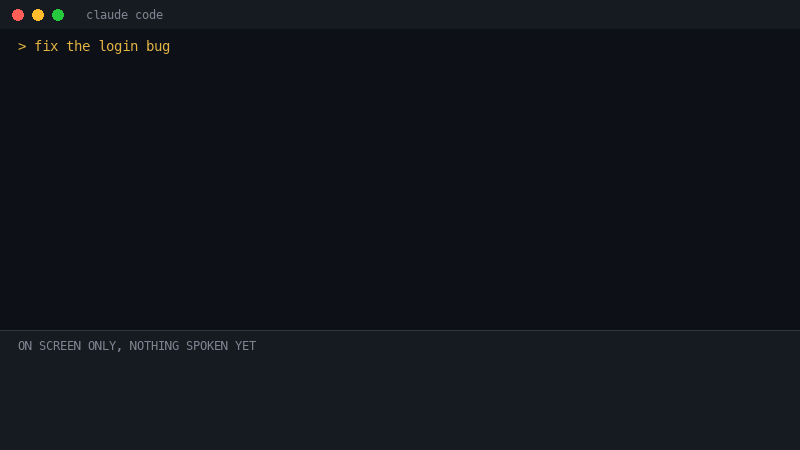

# jarvis-voice


I watched the first *Iron Man* and, like everyone else, I wanted the suit.

That wore off. The suit needs a billionaire and a very forgiving ribcage. What stuck with me was the voice. A guy is working in his garage, and something in the room knows what he's up to. It tells him what matters in one dry sentence, then shuts up and lets him work.

I've wanted that ever since. This repo is my attempt, and it runs on a laptop instead of a cave-built reactor.



*The idea, redrawn for this README, because a GIF can't talk. The real thing uses your speakers.*

## The problem with making your computer talk

I spend my days in Claude Code, and it's great. It also answers like this: four hundred words, a diff, a table and a stack trace.

Making a computer read that aloud is easy. It's also awful. Nobody wants a butler who walks in and recites the entire log file, line numbers included, while you try to remember what you asked for.

JARVIS doesn't read Tony the stack trace. He says the thing a colleague would say across the desk:

> "Login bug's fixed and the tests pass. I haven't pushed it. Want me to?"

So that's the rule here. The screen gets the full reply and your ears get the gist.

## How it actually went

**The voice came first.** I tried five British voices from Kokoro, a small open model that runs on your own machine, so my work doesn't get posted off to yet another voice company. A voice called Fable won. It sounded like it had opinions about my code and was too polite to share them.

**Then the first bill arrived, in seconds.** Summarising a reply through the `claude` command took 70 seconds, because it was politely loading every plugin I've ever installed. Stripped right down, it took 3. I'd also confidently predicted about 2 seconds from "Claude finished" to "voice speaks". Reality came in at about 7. JARVIS would have corrected me sooner.

**Then I opened a second session.** I usually have a few running, and very quickly a calm voice told me "It's fixed, want me to push it?" Fixed what? Which one? Push where? It was like getting a phone call that starts halfway through. So every brief now opens with the project and the task, then takes a breath:

> "Acme API, login bug fix. *(pause)* It's fixed and the tests pass. Want me to push it?"

**Then it got funny.** Here's what happened next, all of it true:

- Claude Code's safety check refused to let Claude install its own voice hook. It was a machine, told not to rewire itself, by another machine. I had to run the command by hand, and I respect it.
- A security review pointed out that a dodgy cloned repo could have sneaked its own code into my hook, and on Windows it could have planted a fake `claude.exe` too. Both are fixed, and tests now guard them.
- My own test suite uninstalled Jarvis from my laptop. It did exactly what I'd written, which is the worst kind of bug.
- Another test passed by reading an old log from an earlier run, so it was proudly reporting a success from the past. It now starts with a clean log.


*Me, after the tests finally passed.*

## What it does today

- Speaks a brief of one or two sentences after each Claude Code reply. It's told to say failures plainly and to read out any questions.
- Opens with the project and task, so you know which session is talking.
- Queues sessions, so they take turns instead of shouting over each other.
- Stays quiet for background `claude -p` runs, because those aren't talking to you.
- Keeps reply text out of its log, which only holds timings and errors.

What it can't do yet: you can't say "Jarvis" to wake it, and you can't talk over it. It also won't fly you anywhere. To speak to it, you use Claude Code's own hold-to-talk.

## Try it

You'll need [uv](https://docs.astral.sh/uv/), `curl`, a signed-in `claude` command and about 340 MB of disk space for the voice.

```sh
git clone https://github.com/Hari-K-Dev/jarvis-voice
cd jarvis-voice
uv sync
.venv/bin/jarvis install    # on Windows: .venv\Scripts\jarvis install
jarvis test
```

`install` downloads the voice, adds a Stop hook and puts `jarvis` in `~/.local/bin`. It backs up your Claude Code `settings.json` first and leaves your other hooks alone. Running sessions normally pick it up within a few seconds, and if one stays silent, restart it.

| Platform | What you need | How far I've tested it |
|---|---|---|
| **macOS** | Apple silicon, macOS 14 or later | Running on my own laptop, tests and all |
| **Linux** | x86_64 or ARM64, glibc 2.28 or later (so not Alpine), and one of `paplay`, `pw-play`, `aplay` or `ffplay`. `espeak-ng` is an optional backup voice. | CI: tests, install and generating a real brief. Not heard by a human yet. |
| **Windows** | x64 or ARM64, Claude Code running natively | CI: same as Linux. Not heard by a human yet. |
| **WSL 2** | The Linux list, plus WSLg for sound | Not tested |

If you try it on Linux or Windows, I'd love to know if it talks to you.

## Talking to it

| Command | What it does |
|---|---|
| `jarvis status` | Shows voice, mute state, hook, models and audio player |
| `jarvis mute` / `jarvis unmute` | Silences every session, including anything playing now |
| `jarvis name "Acme API"` | Sets how the current repo is announced, otherwise it uses the folder name |
| `jarvis say "text"` | Speaks your text as written |
| `jarvis test` | Runs a sample reply through the whole chain |
| `jarvis uninstall` | Removes the hook and the command |

Inside Claude Code, add a `!` in front, like `! jarvis mute`. You can change the voice with `JARVIS_VOICE` and the pace with `JARVIS_SPEED`.

## How it works

1. Claude finishes, and a Stop hook starts a background worker and gets out of the way in a fraction of a second. Your session never waits on the voice.
2. Haiku names the task from your latest request and writes the brief, with no tools, settings or MCP servers loaded. Very short replies are read as written and reuse the session's latest task name.
3. If Haiku can't be reached, you hear the reply's first sentence plus any closing question.
4. Kokoro turns the brief into audio on your machine, and a lock makes sure only one session talks at a time.
5. If Kokoro breaks, your system's built-in voice takes over.

So your reply text only goes to Anthropic, through your own Claude Code sign-in. Each summarised brief uses one Haiku call on your plan. The log and a small `tasks` folder live in `~/.local/share/jarvis-voice`, or `%LOCALAPPDATA%\jarvis-voice` on Windows.

## What's next

- Stop talking the moment I send a new prompt, and say out loud when a session needs my approval.
- Get that 7 seconds down by keeping the voice model loaded.
- A real wake word, so I can say "Jarvis" with my hands full.
- Voice notes over Telegram or WhatsApp for when I'm away from the desk.

The suit remains out of scope.

## Hacking on it

```sh
uv run pytest
uv run ruff check . && uv run ruff format --check .
```

Everything that differs between operating systems is in `src/jarvis_voice/system.py`. CI runs on all three (when GitHub can find a free Mac, which has been rarer than you'd think), then installs into a clean config and generates a real brief with `tests/smoke.py`.

I built this with Claude Code, which felt like the right way to teach Claude Code some manners.

---

MIT licensed, see [LICENSE](LICENSE). That covers my code, not the things below.

<sub>A fan project with no connection to Marvel or Disney. The film GIFs are hosted by Tenor and belong to their owners. "JARVIS" is theirs too, I just really like him.</sub>
